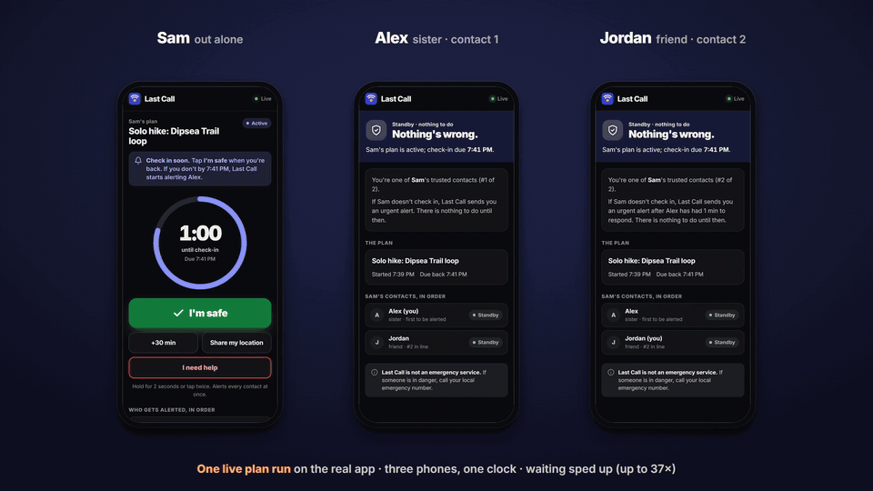
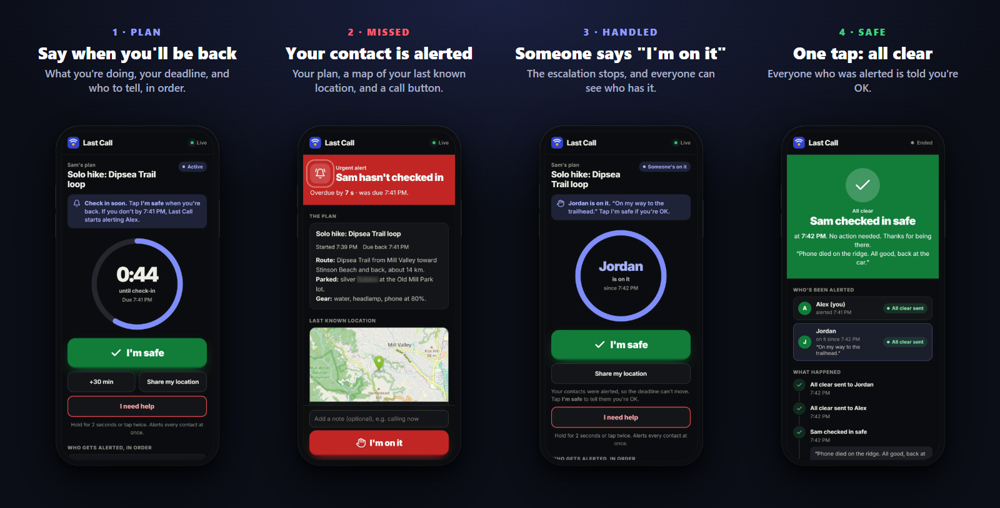
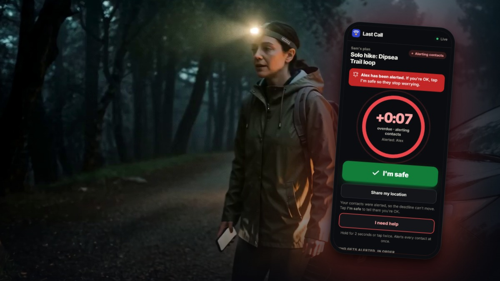
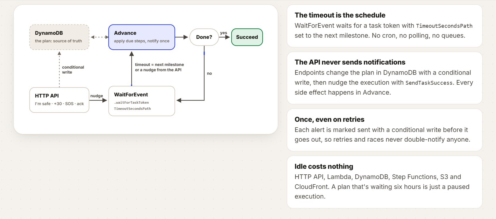
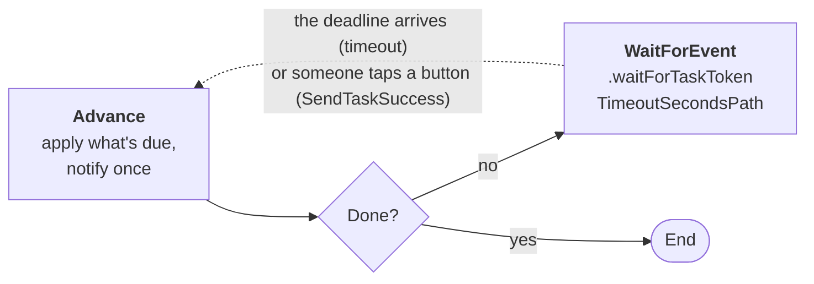
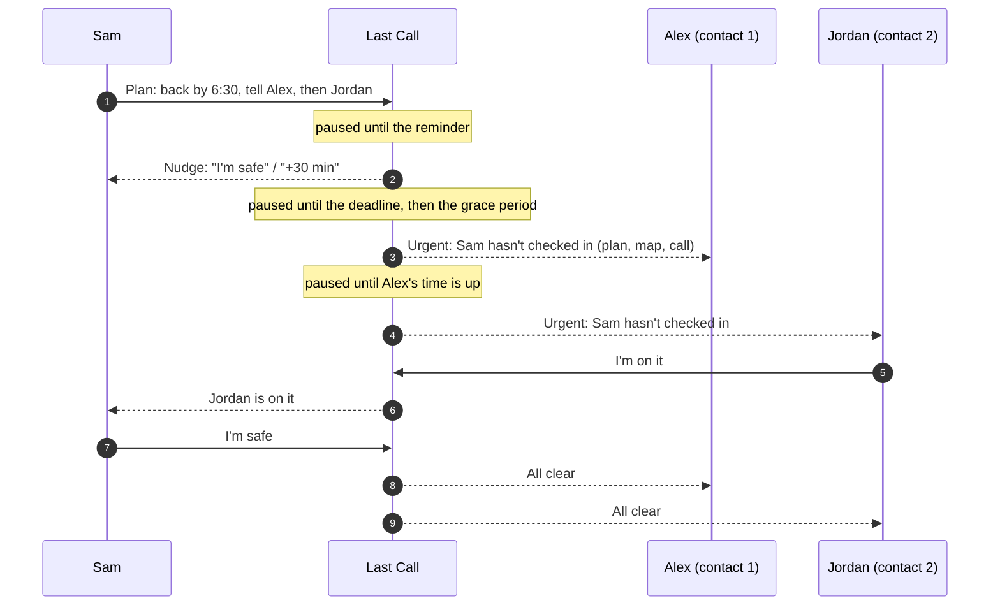

<div align="center">


# Last Call

### If you don't check in, the people you trust find out.

A check-in safety net for anyone doing something alone.<br>
Say when you'll be back. Miss it, and Last Call alerts your people one by one,<br>
with your plan and your last known location, until someone says **"I'm on it"**.

[**Try the live demo**](https://d2ifh0zqxfrt39.cloudfront.net/demo.html) &nbsp;·&nbsp;
[**Watch the 2-minute film**](https://www.youtube.com/watch?v=FnKasCr2pxU) &nbsp;·&nbsp;
[How it works](#how-it-works) &nbsp;·&nbsp;
[Under the hood](#under-the-hood) &nbsp;·&nbsp;
[Run it yourself](#run-it-yourself)


<br>

<a href="https://d2ifh0zqxfrt39.cloudfront.net/demo.html">
  
</a>

<sub>One real plan on the live app, three phones on one clock. The waiting is sped up; nothing else is staged.</sub>

</div>

<br>

## The problem

"Text me when you're home."

Everyone says it. It only works if the other person notices that the text never
came. They have to remember the plan, watch the clock, and decide when quiet
turns into worrying. Most of the time nobody notices for hours.

Last Call does the remembering. A solo hike, a first date, a late shift, a long
drive, a parent who lives alone: tell it once, and it watches the clock so nobody
else has to.

## How it works

<div align="center">
  
</div>

<br>

1. **Make a plan.** What you're doing, when you'll be back, and up to five
   contacts, in order. Add your route, your phone number and your starting
   location if you like. No account: you get a private link, and so does each
   contact.
2. **Get a nudge.** Before the deadline, a push notification with one-tap
   **I'm safe** and **+30 min** buttons. Tap I'm safe and that's the end of it.
3. **Miss it, and Last Call takes over.** After a short grace period, your first
   contact gets an urgent alert with your plan, how overdue you are, a map of your
   last known location and a call button.
4. **It keeps going until someone answers.** If that contact doesn't tap
   **I'm on it** in time, the next one is alerted, and so on down the list.
5. **Back safe?** One tap, and everyone who was alerted gets the all-clear.

Need help right now? Press and hold **I need help** and everyone is alerted at
once.

> [!IMPORTANT]
> Last Call is not an emergency service. If someone is in danger, call your local
> emergency number.

## The film

<div align="center">
  <a href="https://www.youtube.com/watch?v=FnKasCr2pxU">
    
  </a>
  <br>
  <sub><a href="https://www.youtube.com/watch?v=FnKasCr2pxU">Watch on YouTube</a> · 2 minutes · one evening, one missed check-in</sub>
</div>

## Why it's different

| | |
|---|---|
| **Nothing to install, nothing to sign up for** | A plan is a link. Contacts open theirs in any browser. |
| **It escalates** | One person at a time, in the order you chose, until somebody takes it. No group chat where everyone assumes someone else saw it. |
| **It closes the loop** | Contacts see who is handling it, and get an all-clear when you're back. |
| **Alerts that reach people** | Phone push through the free [ntfy](https://ntfy.sh) app, or Slack, Discord or any HTTPS webhook. |
| **Private by design** | Secrets live in the link's fragment, so they never reach a server log, and are stored only as hashes. |
| **Costs nothing to wait** | A six-hour plan is one paused workflow. No server, no cron job, no polling. |

## Under the hood

Everything is serverless and lives in **one AWS SAM template**. No servers, no
containers, no deployment pipeline.



| Service | What it does here |
|---|---|
| **AWS Step Functions** | One Standard execution per plan, running a two-step loop. |
| **AWS Lambda** | Six small API handlers and the two workflow tasks. Node.js 22 on arm64, no dependencies beyond the SDK in the runtime. |
| **Amazon API Gateway** | HTTP API with CORS and throttling. |
| **Amazon DynamoDB** | The source of truth: plans, contacts, events and rate limits in one table, with TTL clean-up. |
| **Amazon S3 + CloudFront** | The web app, with no build step. |

### The one idea worth stealing

Most "wait until a deadline, unless something happens first" systems end up with
a scheduler, a queue and a polling job. Last Call uses one loop:



**Advance** reads the plan, applies whatever is due right now, and returns the
number of seconds until the next milestone. **WaitForEvent** parks a task token
in DynamoDB and sleeps for exactly that long (abridged from
[`lastcall.asl.json`](statemachine/lastcall.asl.json)):

```json
"WaitForEvent": {
  "Type": "Task",
  "Resource": "arn:aws:states:::lambda:invoke.waitForTaskToken",
  "TimeoutSecondsPath": "$.next.waitSeconds",
  "Catch": [{ "ErrorEquals": ["States.Timeout"], "Next": "Advance" }],
  "Next": "Advance"
}
```

The timeout *is* the schedule. A tap on **I'm safe** or **I'm on it** resumes the
execution early with `SendTaskSuccess`. Either way it lands back in Advance, which
works out what to do from the table. That single loop handles the reminder, the
grace period, one-at-a-time escalation, SOS, extensions and the all-clear, for
plans from a minute to a week long.

The same pattern fits lone-worker safety, medication reminders, on-call paging
and SLA breaches.

### A missed check-in, step by step



### Built to be trusted

- **One place for side effects.** API endpoints never send notifications. They
  record the change with a version-checked conditional write and nudge the
  workflow. Only Advance sends, and it marks each notification as sent *before*
  sending it, so retries and races never alert anyone twice. If a nudge is lost,
  the next wake-up catches up from the table.
- **Server time decides.** Deadlines can be relative (`checkInInSeconds`) and
  every response includes the server's `now`, so countdowns are right even on a
  phone with the wrong clock.
- **Safe outbound calls.** Notification URLs come from users, so every request is
  HTTPS-only and refuses private, loopback, link-local and metadata addresses,
  with DNS checked inside the socket lookup to close the rebinding window.
- **Tested against the real thing.** 247 automated tests, plus a 34-check
  end-to-end script that runs real plans against a deployed stack: on-time
  check-in, missed check-in with escalation, extensions, SOS and the all-clear.

## Run it yourself

You need Node.js 22+, the AWS CLI and the AWS SAM CLI, signed in to an AWS account.

```bash
git clone https://github.com/0xSteph/lastcall.git && cd lastcall
npm install
npm run deploy
```

That builds and deploys the stack, uploads the web app and prints your URLs. The
first deploy takes 5 to 10 minutes, mostly CloudFront.

```bash
npm run test:all          # 247 unit and web tests, no AWS needed
npm run e2e -- <ApiUrl>   # 34 end-to-end checks against your stack (~2.5 min)
npm run mock              # the whole app locally, no AWS: http://localhost:8787/web/
```

To remove it, empty the web bucket, then run `sam delete --stack-name lastcall`.

<details>
<summary><b>The API</b> (six endpoints)</summary>

<br>

There are no accounts: `s` is the owner's or a contact's secret from their private
link, and `c` is the contact's position in the list.

| Method and path | Who | What it does |
|---|---|---|
| `POST /v1/plans` | anyone | Create a plan and start its workflow. Returns the owner link and one alert link per contact. |
| `GET /v1/plans/{id}?s=` | owner | The owner's view: status, deadline, contacts, timeline, and the server's `now`. |
| `POST /v1/plans/{id}/checkin?s=` | owner | `{"action": "safe"}`, `{"action": "extend", "minutes": 30}` or `{"action": "sos"}`, with an optional note and location. |
| `POST /v1/plans/{id}/location?s=` | owner | Share a location fix: `{"lat", "lng", "accuracy"}`. |
| `GET /v1/plans/{id}/alert?c=&s=` | contact | The contact's view: the plan, how overdue it is, the last known location, who has been alerted. |
| `POST /v1/plans/{id}/ack?c=&s=` | contact | "I'm on it", with an optional note. Stops the escalation. |

A plan needs a `name`, an `activity`, a deadline (`checkInBy` as an ISO time, or
`checkInInSeconds` so the server computes it) and one to five `contacts`. Optional
fields: `details`, `routeUrl`, `phone`, `location`, `timeZone`, `ownerNotifyUrl`,
and the timings `remindMinutesBefore`, `graceMinutes` and `ackMinutes`.

The check-in and acknowledge endpoints also accept their action in the query
string (`a=safe`, `a=extend&m=30`, `a=ack`) with no body, which is what makes the
one-tap buttons in a push notification work. Plan creation is limited to 20 plans
per source IP per UTC day by default (`DAILY_PLAN_CAP`).

</details>

<details>
<summary><b>Repository layout</b></summary>

<br>

| Path | What |
|---|---|
| `template.yaml` | AWS SAM template: API, functions, state machine, table, web hosting |
| `statemachine/lastcall.asl.json` | The Advance / WaitForEvent loop |
| `src/handlers/` | API handlers and the two workflow tasks |
| `src/lib/` | Timing rules, state changes, messages, notification presets, safe outbound HTTP |
| `web/` | Landing page, plan creation, owner page, contact alert page, live demo (vanilla JS, no build step) |
| `mock/` | In-memory mock of the API for local development, plus web tests |
| `tests/` | Backend unit tests, including a full simulated plan lifecycle |
| `scripts/` | Deploy, validate and end-to-end test scripts |
| `assets/` | Images used in this README |

</details>

## Questions

<details>
<summary><b>Do my contacts need an app or an account?</b></summary>

<br>

No. Each contact gets a link that opens in any browser. For alerts that buzz
their phone, they can subscribe to their own push channel in the free ntfy app,
or you can point their alerts at Slack, Discord or any webhook.

</details>

<details>
<summary><b>What if my phone dies or I have no signal?</b></summary>

<br>

That is the case Last Call is built for. The deadline lives in AWS, not on your
phone. If you can't check in, the alerts go out anyway.

</details>

<details>
<summary><b>Why Step Functions and not a cron job or a scheduler?</b></summary>

<br>

A plan is a long wait that has to end the moment something happens. One execution
per plan gives you both: `.waitForTaskToken` with a timeout sleeps until the next
deadline for free, and `SendTaskSuccess` wakes it instantly when someone taps a
button. You also get each plan's full history in the Step Functions console
without building anything.

</details>

<details>
<summary><b>What does it cost to run?</b></summary>

<br>

Step Functions Standard bills per state transition, and a waiting plan makes
none. Lambda runs for a few milliseconds per event, and DynamoDB is on-demand.
There is nothing that bills by the hour.

</details>

<details>
<summary><b>Is the film real?</b></summary>

<br>

Every phone screen in the [film](https://www.youtube.com/watch?v=FnKasCr2pxU) is
the real app, recorded from one live plan run. The story footage is AI-generated
and the narration is an AI clone of the author's own voice.

</details>

## Ideas for later

- SMS and voice-call alerts for contacts who don't use push
- Recurring plans, such as a daily check-in for a parent who lives alone
- Shared plans for groups

Issues and pull requests are welcome.

## Licence

[MIT](LICENSE). Built for the AWS Builder Center weekend challenge
"No Pipeline, No Problem".

<div align="center">
<br>

**If Last Call would have helped you or someone you know, a star helps other people find it.**

</div>
